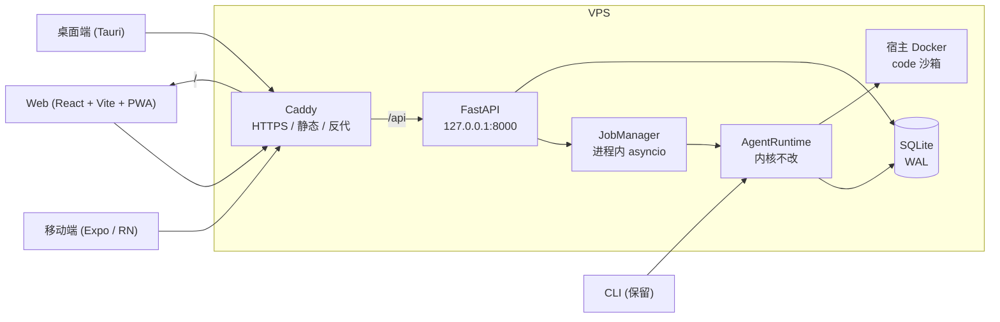

# 多端前端方案（Web / 移动 / 桌面）

> 项目：asagent 多用户前端平台
> 版本：v1.0（已确认）
> 日期：2026-11-23
> 状态：F0–F6 完成（F6 部署与工程化已验收，见第 10 节）

---

## 1. 背景与目标

M0–M6 已完成手写 Agent 内核、四个场景包、评测闭环与 CI。当前只有 CLI，没有服务端与客户端。

本方案在不改动 Agent 内核语义的前提下，新增：

1. **服务端 API 层**（FastAPI）：认证、会话、事件流、审批、评测、审计、MCP、系统状态。
2. **Web 端**（React + Vite）：完整控制台，可安装为 PWA。
3. **移动端**（Expo / React Native）：iOS / Android。
4. **桌面端**（Tauri v2）：Windows 安装包，复用 Web 构建。
5. **公网部署**：VPS + Caddy（自动 HTTPS）+ systemd。

核心原则：**内核是唯一真相源**。会话、事件、审批记录仍在 SQLite；前端只是读写这些状态的另一种入口。API 层不得绕过 `ToolRegistry`、Guard、审批与预算机制。

### 已确认的决策

| 决策 | 选择 |
|---|---|
| App 形态 | 移动端 + 桌面端都要 |
| 前端栈 | React + Vite |
| 用户模型 | 多用户账号 |
| 首期范围 | 全量页面，分 6 批推进 |
| 账号开通 | 邀请码注册 |
| 部署环境 | 公网 VPS |
| 模型密钥 | 服务端统一 DeepSeek key |
| 桌面实现 | Tauri 安装包 + PWA 入口 |
| code 场景 | 公网开放（仅 admin + 资源限制） |

---

## 2. 非目标

- 不做多租户计费与支付。
- 不做邮箱验证、短信验证（邀请码 + 限流替代）。
- 不做水平扩展与外部任务队列（`workers=1`）。
- 不做 token 级流式输出（模型客户端保持非流式，前端是「事件级」进度）。
- 不重写内核的工具、Guard、路由与评测逻辑。

---

## 3. 总体架构



### 关键约束

- `JobManager` 在进程内，**uvicorn 必须单 worker**。
- 后台任务与 API 请求共享同一个 SQLite：WAL + `busy_timeout` + 全局并发信号量。
- 事件流从 `events` 表增量读取，**不给内核加回调**。

---

## 4. 多用户模型

### 4.1 角色

| 角色 | 权限 |
|---|---|
| `admin` | 全部会话、用户管理、邀请码、评测、系统页、code 场景 |
| `user` | 自己的会话、审批、trace、审计、MCP 列表 |

### 4.2 数据模型

内核表只增加一列：

```text
sessions.owner_id TEXT NULL     -- CLI 创建为 NULL；API 创建为用户 ID
```

API 层新增表（同一 `state.db`）：

```sql
CREATE TABLE users(
  id TEXT PRIMARY KEY,
  username TEXT NOT NULL UNIQUE,
  password_hash TEXT NOT NULL,
  role TEXT NOT NULL DEFAULT 'user',
  disabled INTEGER NOT NULL DEFAULT 0,
  created_at TEXT NOT NULL,
  last_login_at TEXT
);

CREATE TABLE invites(
  id TEXT PRIMARY KEY,
  code_hash TEXT NOT NULL UNIQUE,
  created_by TEXT NOT NULL,
  role TEXT NOT NULL DEFAULT 'user',
  expires_at TEXT,
  max_uses INTEGER NOT NULL DEFAULT 1,
  used_count INTEGER NOT NULL DEFAULT 0,
  revoked INTEGER NOT NULL DEFAULT 0,
  created_at TEXT NOT NULL
);

CREATE TABLE refresh_tokens(
  id TEXT PRIMARY KEY,
  user_id TEXT NOT NULL,
  token_hash TEXT NOT NULL UNIQUE,
  expires_at TEXT NOT NULL,
  revoked_at TEXT,
  created_at TEXT NOT NULL
);

CREATE TABLE user_quotas(
  user_id TEXT PRIMARY KEY,
  max_cost_per_session REAL,
  daily_cost_limit REAL,
  concurrent_sessions INTEGER NOT NULL DEFAULT 1,
  eval_daily_limit INTEGER NOT NULL DEFAULT 0
);

-- 知识库：文档元数据（正文落在 data/docs/*.md）
CREATE TABLE kb_docs(
  doc_id TEXT PRIMARY KEY,
  title TEXT NOT NULL,
  sha256 TEXT NOT NULL,
  size INTEGER NOT NULL,
  version INTEGER NOT NULL DEFAULT 1,
  created_by TEXT,
  updated_by TEXT,
  created_at TEXT NOT NULL,
  updated_at TEXT NOT NULL,
  deleted_at TEXT,
  trash_path TEXT
);

-- 知识库：版本历史（只保留最近 20 版）
CREATE TABLE kb_versions(
  doc_id TEXT NOT NULL,
  version INTEGER NOT NULL,
  content TEXT NOT NULL,
  sha256 TEXT NOT NULL,
  author_id TEXT,
  created_at TEXT NOT NULL,
  PRIMARY KEY(doc_id, version)
);

-- 知识库：重建任务（重启后仍可展示最后状态）
CREATE TABLE kb_jobs(
  id TEXT PRIMARY KEY,
  scope TEXT NOT NULL,              -- full | docs
  doc_ids_json TEXT,
  status TEXT NOT NULL,             -- queued|running|done|failed
  chunks INTEGER,
  error TEXT,
  started_at TEXT,
  finished_at TEXT
);
```

### 4.3 认证流程

- 密码：`argon2id`（`pwdlib[argon2]`）。
- 登录成功返回：
  - `access_token`：JWT，30 分钟，放内存。
  - `refresh_token`：随机串，30 天，库里只存 SHA-256；Web 放 `httpOnly + Secure + SameSite=Strict` cookie，App/桌面放系统安全存储。
- `POST /api/auth/refresh` 轮换 refresh token（旧的立即吊销）。
- `POST /api/auth/logout` 吊销当前 refresh token。
- 邀请码注册：事务内校验并消费，见 §5.3。
- 初始管理员：`uv run asagent web-init-admin`（读 `AS_ADMIN_USER` / `AS_ADMIN_PASSWORD`）。

### 4.4 资源隔离

| 资源 | 隔离方式 |
|---|---|
| 会话 | `sessions.owner_id`；所有查询与操作强制归属校验，越权返回 404 |
| 消息/事件 | 通过会话归属间接隔离 |
| artifact | 先查 artifact 的 `session_id`，再校验会话归属 |
| workspace | `runtime/workspace/<user_id>/<session_id>` |
| office 文档 | 每用户一个文档根；共享语料只读 |
| code 隐藏测试 | 全局只读，Web 端不可指定 |
| 评测 | 仅 admin；按 `eval_daily_limit` 限次 |
| 审计 | 普通用户只看自己的；admin 可看全部 |

### 4.5 配额与成本

| 层级 | 来源 | 超限行为 |
|---|---|---|
| 单会话 | 请求参数 `max_cost_cny`，上限取用户配额 | 内核预算刹车，`FAILED` |
| 用户每日 | `user_quotas.daily_cost_limit` | 拒绝新建会话（429） |
| 用户并发 | `user_quotas.concurrent_sessions` | 429 |
| 全局并发 | 进程内 `Semaphore`（默认 4） | 排队 |
| 评测 | admin + 每日次数 | 拒绝 |

每日成本从 `model_response` 事件的 usage 累计（按 `models.yaml` 定价），定时任务跨日清零。页面只显示「key 已配置」，不返回明文。

### 4.6 知识库

**归属决策**：全局共享，登录用户均可编辑；检索方是所有 `rag` 场景会话。

知识库分两层，语义不同，不能混为一谈：

| 层 | 内容 | 何时生效 |
|---|---|---|
| 文档层 | `data/docs/<doc_id>.md` + `kb_docs` 元数据 | 写入即生效 |
| 索引层 | `rag_chunks`（分块 + bge 向量） | 需重建后才对检索生效 |

前端必须区分「已保存」与「已被索引」：文档改动后状态置为 `stale`，直到重建完成。

**增量索引**（对 `src\asagent\tools\rag\index.py` 的改动）：

- `build(doc_ids: list[str] | None = None)`：传 `doc_ids` 时只删除并重算这些文档的 chunk；`None` 时保持现有全量语义。
- CRUD 接口落盘后按单文档增量重建（秒级）；「全量重建」按钮用于换 embedding 模型、改分块参数等场景。
- `_fingerprint` 从 `mtime + size` 改为文件内容 sha256，避免「删除后同名同大小重建」被误判为最新。
- `_load()` 每次调用前比对 `rag_meta.fingerprint` 与内存持有值，不一致则丢弃 `_matrix`/`_rows` 重新加载——否则 API 重建后已有的 `RagIndex` 实例会一直返回旧索引。

**重建任务**：编码是 CPU 密集任务，必须异步执行，否则会阻塞单 worker 的整个 API。

```text
POST /api/kb/reindex        → 202 {"job_id": "rj_...", "status": "queued"}
GET  /api/kb/jobs/{id}      → {"status": "running|done|failed", "chunks", "elapsed", "error"}
```

- 进程内单飞锁：已有任务运行时返回 409，并附带当前 `job_id`。
- 冷却：两次全量重建间隔不少于 60 秒；增量重建不受限。
- 重建完成后 `kb_docs` 与 `rag_meta` 的时间戳同步更新，前端据此判断 `stale`。

**全员可编辑的补偿措施**（安全面）：

1. **读取侧防线不变**：`search_docs` 结果走 `tool_result`，`GuardPipeline` 会检测注入（`guard/pipeline.py`），命中后内核在最终回答追加安全提示（`loop.py`）。写入不受限不等于投毒必然生效。
2. **版本历史**：每次写入在 `kb_versions` 留一版，保留最近 20 版；`POST /api/kb/docs/{id}/rollback` 可回滚。
3. **回收站**：删除为软删除，文件移入 `data/docs/.trash/`，保留 7 天，可由 admin 恢复。
4. **内容扫描**：写入时复用 `_looks_like_injection` 扫描，命中则在 `kb_docs` 标记 `suspicious=1`，列表中打「含可疑指令」徽章（HTML 注释同样提示），admin 页面可一键下架。
5. **审计**：每次写操作记录 `user_id / doc_id / version / sha256 / size / diff 增删行数 / git 风格时间`，进审计页。
6. **限流与配额**：每用户写入 30 次/分钟；文档总数上限 500、单文件 2 MB、总量 50 MB，超限 429。
7. **落盘安全**：`doc_id` 必须匹配 `[A-Za-z0-9_-]+`（与 `read_doc` 校验一致），仅接受 `.md`/`.txt`；写临时文件后 `os.replace` 原子替换；覆盖前先备份到 `.trash/`。
8. **重建限流**：所有登录用户可触发，但受单飞锁 + 冷却约束；管理员的触发优先。

---

## 5. 后端 API

### 5.1 通用约定

- 前缀 `/api`，JSON；错误统一 `{"error": {"code", "message", "detail?"}}`。
- 鉴权：`Authorization: Bearer <access_token>`。
- 分页：`limit`（默认 20，最大 100）、`offset`。
- 时间：ISO 8601 本地时间字符串，与现有事件一致。
- 所有写接口校验 `Origin`，拒绝跨站。

### 5.2 接口清单

```text
# 认证
POST   /api/auth/register            邀请码注册
POST   /api/auth/login
POST   /api/auth/refresh
POST   /api/auth/logout
GET    /api/auth/me

# 用户（admin）
GET    /api/users
POST   /api/users
PATCH  /api/users/{id}
POST   /api/users/{id}/password
GET    /api/invites
POST   /api/invites
POST   /api/invites/{id}/revoke

# 场景与系统
GET    /api/profiles
GET    /api/health
GET    /api/system/info              admin（路径/provider/模型/密钥布尔状态）
GET    /api/system/mcp?profile=      admin（只读配置，不启动子进程）

# 会话
GET    /api/sessions
POST   /api/sessions                 202 + session_id
POST   /api/sessions/{id}/continue   202，同一会话追加一轮（本轮步数/预算）
GET    /api/sessions/{id}
GET    /api/sessions/{id}/messages
GET    /api/sessions/{id}/events?after_seq=
GET    /api/sessions/{id}/stream     SSE
POST   /api/sessions/{id}/resume
POST   /api/sessions/{id}/cancel
DELETE /api/sessions/{id}            仅删除前端可见记录（不删内核数据）

# 审批与审计
GET    /api/sessions/{id}/approvals
POST   /api/sessions/{id}/approvals
GET    /api/sessions/{id}/artifacts/{artifact_id}
GET    /api/audit?session_id=

# 知识库（全局共享，登录用户可编辑）
GET    /api/kb/docs                   列表（含索引状态、编辑者、可疑标记）
GET    /api/kb/docs/{doc_id}          正文 + 元数据
PUT    /api/kb/docs/{doc_id}          新增或覆盖（写入 + 版本 + 单篇增量索引）
DELETE /api/kb/docs/{doc_id}          软删除进回收站
POST   /api/kb/docs/{doc_id}/rollback 回滚到指定版本
POST   /api/kb/docs/{doc_id}/restore  从回收站恢复（admin）
GET    /api/kb/status                 文档数/chunk 数/索引时间/模型/fingerprint/stale
POST   /api/kb/reindex                202 + job_id（全量）
GET    /api/kb/jobs/{job_id}          重建任务状态
GET    /api/kb/audit                  知识库写操作历史

# 评测（admin；同一时刻单飞）
GET    /api/evals/suites             场景包 + 是否有可用评测集
GET    /api/evals/status             running / 今日已用 / 每日上限
POST   /api/evals/run                202 + job_id；409 单飞；429 次数用尽
GET    /api/evals/jobs?limit=
GET    /api/evals/jobs/{job_id}
GET    /api/evals/reports?limit=     扫描 runtime/evals/*.json
GET    /api/evals/reports/{report_id}
```

### 5.3 邀请码注册

```text
POST /api/auth/register
{ "username": "...", "password": "...", "invite_code": "..." }
```

事务步骤：

1. `invite_code` 哈希后查 `invites`；
2. 校验 `revoked=0`、未过期、`used_count < max_uses`；
3. 创建用户；
4. `used_count += 1`；
5. 同一事务提交。

失败统一返回 `invalid_invite`，不区分「不存在 / 过期 / 用完」。

### 5.4 事件流

**Web：SSE**

```text
GET /api/sessions/{id}/stream?after_seq=123
event: agent_event
id: 124
data: {"seq":124,"ts":"...","type":"tool_result","payload":{...}}

: heartbeat        （每 15 秒）
```

实现：`StreamingResponse`，每 200ms 调 `store.events(session_id, after_seq)`；会话终态且无新事件时发送 `event: done` 后关闭。

**App / 桌面：增量轮询**

```text
GET /api/sessions/{id}/events?after_seq=123
```

同一份事件结构，客户端维护 `after_seq`。断线/切后台后从最后 seq 继续，不丢事件。

### 5.5 任务与审批

- `POST /api/sessions`：校验配额 → 创建任务 → 后台 `asyncio.create_task` 跑 `runtime.run(owner_id=...)` → 返回 202。
- `POST /api/sessions/{id}/continue`：同一会话追加一轮。仅 `done`/`failed` 且无运行中任务时允许；
  内核把上一轮最终回答固化为 assistant 消息，步数与成本继续累计，但 `max_steps`/预算按
  「当前累计 + 本轮额度」换算；`FINAL` 事件带 `round_steps`/`round_cost` 供前端按轮展示。
  日配额按本轮增量记账（`JobManager` 用运行前后 cost 差值），不会重复计费。
- 同一 session 已有运行中任务：返回 409（状态刚落 `done`、后台仍在收尾时同样如此）。
- `POST /api/sessions/{id}/cancel`：`task.cancel()` → 显式写 `FAILED` + `error="用户取消"` + `error` 事件（`CancelledError` 不会被 `except Exception` 捕获，必须由 API 层兜底落盘）。
- `POST /api/sessions/{id}/approvals`：等价于 CLI 的 `approve`：`decide_approval` + `approval_decided` 事件；可选 `resume=true` 立即继续。
- 审批列表来自 `tool_invocations(status='started')` 且 `permission > READ`。

---

## 6. 前端

### 6.1 页面

| 优先级 | 页面 | 要点 |
|---|---|---|
| P0 | 登录 / 注册 | 邀请码注册、记住我（refresh cookie） |
| P0 | 会话列表 | 状态/场景/成本/时间；筛选、分页 |
| P0 | 新会话 | profile、模型、max_steps、max_cost、workspace 白名单选择 |
| P0 | 对话页 | 消息流 + 事件时间线 + 审批卡片 + 停止 + 成本；结束后原地追问（不新建会话），最终回答下展示本轮步数/成本 |
| P0 | 会话详情 | trace、artifact、审批历史、消息原文 |
| P0 | 知识库 | 文档列表、上传/编辑、删除（回收站）、版本历史、索引状态条、重建索引（异步进度）、可疑内容徽章 |
| P1 | 评测 ✅ | admin 触发（场景/模型/重复/用例上限）、进度、历史报告、失败分类、成本；每日次数与单飞 |
| P1 | 审计 ✅ | 写操作表（路径、备份、sha256、结果）；管理员全局，普通用户按会话 |
| P1 | MCP / 系统 ✅ | 路径、provider/模型、密钥布尔状态、MCP 配置（只读，不启动子进程） |
| P1 | 管理 | 用户、邀请码、配额 |
| P2 | 设置 | 改密码、默认预算、主题 |

### 6.2 Web 技术栈

- React 18 + TypeScript + Vite
- Tailwind CSS v4
- TanStack Query（服务端状态）
- react-router-dom
- zustand（本地 UI 状态）
- react-markdown + remark-gfm（最终答案）
- lucide-react（图标）
- vite-plugin-pwa

### 6.3 移动端

- Expo SDK 58 + expo-router（`app/src/app`）+ TypeScript；React Native 0.88 / React 19
- **API 地址构建时写死**：`app/src/lib/config.ts` 默认 `https://agent.woaiwyj.xin`，
  登录页不提供输入框；联调时用 `EXPO_PUBLIC_API_BASE` 在打包阶段覆盖
- 认证：请求头 `X-Client: mobile`，refresh token 走响应体；原生端 SecureStore，
  Web 预览降级 localStorage；启动时用刷新令牌 `bootstrap` 恢复登录，
  401 单飞刷新并重试一次，刷新失败自动回到登录页
- 事件走轮询（RN 对 SSE 支持弱）：`GET /api/sessions/{id}/events?after_seq=`，
  1.5s 一次、终态停止，按 seq 去重合并；页面：登录/注册、会话列表、新建任务、
  详情（消息、轨迹、审批、最终答案、成本）
- 审批：`GET/POST /api/sessions/{id}/approvals`，决策后自动 resume；等待审批期间
  前端隐藏内核写给 CLI 的暂停提示，只展示审批卡片
- 本地 Web 预览需后端放行 `http://localhost:8082`
  （`AS_ALLOWED_ORIGINS=http://localhost:8082`）
- 构建需 Node ≥ 22.13；真机预览用 Expo Go；正式分发：Android 用 EAS Build，
  iOS 需 Apple 开发者账号
- 验收记录（2026-11-23）：Expo Web 390×844 完成登录、SQL 对话（本地
  qwen2.5-7b，成本 ¥0）、刷新页面自动登录、Office 审批→写文件；`tsc --noEmit`
  通过；后端 ruff 干净、176 条 pytest 全绿。截图见 `runtime/mobile-f4-*.png`

### 6.4 桌面端

- Tauri v2 加载 `web/dist`，窗口源为 `http(s)://tauri.localhost`
- 桌面端带 `X-Client: desktop` 请求头：后端在登录/注册/刷新响应体返回 refresh token；
  Tauri 命令写入 Windows Credential Manager（`com.asagent.desktop`），登出时删除
- API base 写死：`desktop/api-base.txt` 由 `src-tauri/build.rs` 注入构建产物，
  登录页不提供输入框；仅保留进程级 `ASAGENT_API_BASE` 覆盖（本地联调/运维）。
  当前内置地址为 `https://agent.woaiwyj.xin`（Cloudflare named tunnel，
  `cloudflared` 配置见 `runtime/cloudflared-asagent.yml`，入口指向本机 `8080`）
- 后端 `AS_DESKTOP_CLIENTS=true` 时 CORS 放行 `tauri://localhost`、
  `http(s)://tauri.localhost`，并允许 `X-Client` 头
- CSP 收紧：`script-src 'self'`，仅允许 API 所在的 https 与本机开发端口
- 验收记录（2026-11-23）：NSIS 安装包
  `desktop\src-tauri\target\release\bundle\nsis\asagent_0.1.0_x64-setup.exe`
  静默安装到本机后实测通过——登录、SQL 对话、Office 审批写文件、登出后 keyring 清空、
  重启应用后凭 keyring 自动登录；后端 `ruff` 与 183 条 pytest 全绿。
  随后按「地址写死」要求移除登录页输入框，改为构建时注入 `api-base.txt`

### 6.5 共享包

`packages/shared`：

- zod schema（与后端 Pydantic 对齐）
- API client（fetch 封装、token 刷新、错误规范化）
- 事件归并逻辑（把事件流折叠成「消息 + 步骤」视图）
- 审批/会话类型

Web 与 App 共用；Tauri 直接复用 Web。

> 现状：F2/F4/F5 实施时 Web 与 App 各自维护 `src/lib`（类型、API、事件归并），
> 共享包尚未抽取；两端的接口契约由后端 Pydantic 模型与集成测试保证。
> 后续如需合并，可把 `app/src/lib` 与 `web/src/lib` 的公共部分迁入 `packages/shared`。

---

## 7. 目录结构

```text
D:\code\AS\
├─ src\asagent\api\
│  ├─ app.py            # FastAPI 实例、静态托管、异常处理
│  ├─ config.py         # WebSettings（JWT secret、域名、配额默认值）
│  ├─ db.py             # users/invites/tokens/quotas 表与迁移
│  ├─ security.py       # argon2、JWT、refresh 轮换
│  ├─ deps.py           # current_user、require_admin、会话归属校验
│  ├─ jobs.py           # JobManager、全局并发、取消
│  ├─ schemas.py        # 请求/响应模型
│  └─ routers\
│     ├─ auth.py users.py invites.py
│     ├─ sessions.py approvals.py audit.py
│     ├─ kb.py                      # 知识库文档 CRUD + 异步重建任务
│     ├─ evals.py mcp.py system.py
├─ web\                 # React SPA + PWA
├─ app\                 # Expo 移动端
├─ desktop\             # Tauri 壳（src-tauri）
├─ packages\shared\     # TS 类型与 API client
├─ tests\test_api_*.py
├─ deploy\
│  ├─ Caddyfile
│  ├─ asagent-api.service
│  └─ backup.sh
└─ docs\frontend-plan.md
```

---

## 8. 公网安全基线

1. TLS：Caddy 自动签发，HSTS；只开放 80/443。
2. 监听：FastAPI 绑 `127.0.0.1`，禁止直连。
3. 认证：access 30min、refresh 30d、轮换、可吊销。
4. Cookie：`httpOnly + Secure + SameSite=Strict`。
5. CSRF：写接口校验 `Origin` + 自定义头。
6. 限流：登录/注册按 IP + 用户名；创建会话按用户。
7. 密码：argon2id，最少 12 位。
8. 越权：依赖注入统一校验，默认拒绝，越权 404。
9. 日志：不记录 token、密码、query 串；工具输出走现有 `redact`。
10. 备份：`scripts/backup.py`（SQLite backup API）每日计划任务执行，保留 7 天。
11. `.env` 权限 600，`AS_JWT_SECRET` 随机 64 字节。
12. code 场景：仅 admin，容器 CPU/内存/网络限制，执行在独立低权限目录。

---

## 9. 部署（本机 Docker + Cloudflare 隧道）

当前生产形态：本机 Windows 用 Docker 跑 API 容器，Cloudflare named tunnel 把
`https://agent.woaiwyj.xin` 指向 `127.0.0.1:8080`。

```text
Internet ── HTTPS ──▶ Cloudflare 边缘 ── QUIC tunnel ──▶ cloudflared（Windows 服务）
                                                              │ http://127.0.0.1:8080
                                                              ▼
                                                    asagent-api 容器 :8000
                                                      ├─ runtime/ data/（读写卷）
                                                      ├─ configs/ evals/（只读卷）
                                                      └─ /var/run/docker.sock（code 沙箱，仅 Linux）
```

- 镜像：`deploy/Dockerfile` 多阶段（web 构建 + Python 运行时），compose 见
  `deploy/docker-compose.yml`；`restart: unless-stopped` + 健康检查 + 日志轮转
- 自启：`deploy/windows/install-tasks.ps1` 注册登录时启动 compose 的计划任务；
  `install-cloudflared-service.ps1` 把隧道装成 Windows 服务
- 备份：`scripts/backup.py` 每日 03:17 由计划任务执行，保留 7 天
- code 沙箱：容器内 docker CLI 调宿主 daemon，`AS_SANDBOX_PATH_MAP` 做路径映射。
  **Windows 限制**：Docker Desktop 把 named pipe 挂进 Linux 容器后是空目录而非
  socket，实测 `permission denied ... /var/run/docker.sock`，因此本机容器部署下
  code 场景不可用（错误信息会附带提示），需宿主直跑或改用 Linux 部署；其余场景
  不受影响
- 完整步骤、恢复与排障见 `docs/deploy.md`

Linux VPS 备选（同一 compose，`DOCKER_SOCKET=/var/run/docker.sock`），不用隧道时
可用 Caddy/systemd：

```text
/etc/caddy/Caddyfile
  example.com {
    encode zstd gzip
    handle /api/* {
      reverse_proxy 127.0.0.1:8080
    }
    handle {
      root * /srv/asagent/web/dist
      try_files {path} /index.html
      file_server
    }
  }
```

Linux 宿主需要 Docker 供 code 沙箱使用；容器内以 uid 10001 的非 root 用户运行，
需能访问 docker socket（GID 与宿主不一致时用 `group_add`）与挂载目录。
Windows 宿主受 named pipe 限制，见上方说明。

---

## 10. 实施批次与验收

| 批次 | 内容 | 验收标准 |
|---|---|---|
| **F0** | 内核小改：`owner_id`、`list_sessions` 扩展、迁移 | 现有 147 测试全绿；新增归属/迁移/过滤测试通过；ruff 干净 |
| **F1** | 认证、邀请码、用户、配额、JobManager、SSE、会话、审批、越权 | pytest：注册/登录/刷新、越权 404、审批→resume 全链路、配额拒绝 |
| **F1.5** | 知识库：增量索引、缓存失效、文档 CRUD、版本/回收站、异步重建、审计 | pytest：增删改 → 单篇增量索引只重算该文档；全量重建 job 状态流转；单飞锁 409；索引缓存失效后检索到新内容；注入文档被标记；路径穿越与超大文件被拒 |
| **F2** | Web 全部页面 + PWA（含知识库 tab） | 浏览器完成 SQL 与 Office（含网页审批）流程；知识库上传/编辑/删除/重建全链路；可安装 |
| **F3** | Tauri 桌面壳 | Windows 安装包登录、对话、审批 |
| **F4** | Expo 移动端 | ✅ Expo Web 验收：登录、SQL 对话、刷新恢复、Office 审批写文件、成本展示；typecheck 通过（Android 真机待有设备时补测） |
| **F5** | 评测 / 审计 / MCP / 系统页 | ✅ 浏览器验收（2026-11-23）：admin 触发 SQL 单用例评测（deepseek-chat）→ 任务完成 → 报告自动出现在列表并可回看明细；审计页展示全局写操作；系统页显示 demo MCP 服务与 provider 状态；管理页可设「评测/日」；pytest 183 条全绿 |
| **F6** | 本机 Docker + 隧道、自启、备份、CI、Playwright E2E、文档 | ✅ 验收记录（2026-11-23）：`asagent-api:local`（708MB，CPU torch）容器 `Up (healthy)`，`127.0.0.1:8080` 与公网 `https://agent.woaiwyj.xin/api/health` 均 200；Web SPA 正常；备份 34 文件/9.2MB 且保留 7 份；pytest 195 条、ruff 干净；Playwright 12 用例全绿；CI 四 job（test/web/app/e2e）与 release（`v*` → NSIS）就绪。已实测并记录 Windows 容器下 code 沙箱不可用（named pipe 限制），Linux 路径映射单测通过 |

> 范围不缩减；分批是为了每批可审、可回滚、可验收。

---

## 11. 测试策略

- **后端**：pytest + `httpx.ASGITransport`；临时 SQLite；模型用 `ScriptedClient`，不打真实 API。
- **越权矩阵**：每个会话级接口都测「他人会话 → 404」。
- **并发**：同一 session 重复提交 → 409；全局信号量生效。
- **内核回归**：现有 147 条测试保持全绿。
- **前端 E2E**：Playwright（`e2e/` 独立包，端口 8179 + 临时库 + 不调用模型）：
  登录/登出、权限路由、知识库增删、管理页配额与邀请码、评测/审计/系统页渲染。
  事件归并等纯逻辑仍由运行时 pytest 覆盖。
- **移动端**：typecheck + lint；关键流程手工验收。
- **CI**：`test`（ruff + pytest）、`web`（typecheck + build）、`app`（tsc）、
  `e2e`（Playwright，失败上传报告）四个 job；桌面打包由 `release.yml` 在 tag 时构建。

---

## 12. 风险与对策

| 风险 | 对策 |
|---|---|
| 成本失控 | 五层限额（会话/用户日/用户并发/全局/评测） |
| SQLite 写锁 | WAL + `busy_timeout` + 同会话串行 + 全局信号量 |
| 越权 | 统一依赖校验，越权 404，测试矩阵覆盖 |
| 进程重启僵尸会话 | 启动时把 `RUNNING` 置 `FAILED`，允许 resume |
| code 场景逃逸 | 仅 admin、Docker 资源限制、路径白名单 |
| RN 无 SSE | App 用 `after_seq` 轮询 |
| iOS 分发 | 需 Apple 开发者账号；先用 Expo Go 预览 |
| 单 worker 限制 | 在部署文档中明确；扩容需外部队列，属后续演进 |

---

## 13. 附：F0 内核改动明细

改动范围（约 30 行）：

1. `SessionState` 增加 `owner_id: str | None = None`。
2. `checkpoint._SCHEMA` 的 `sessions` 表增加 `owner_id TEXT`；启动时用 `PRAGMA table_info` 做轻量迁移。
3. `CheckpointStore.create_session(profile, title=None, owner_id=None)` 写入归属。
4. `save_state` 持久化 `owner_id`。
5. `list_sessions(limit, offset, owner_id=None, profile=None, status=None)` 支持过滤与分页。
6. `AgentRuntime.run(..., owner_id=None)` 透传给 `create_session`。
7. 新增 `tests/test_multiuser.py`：归属持久化、旧库迁移、过滤分页、runtime 透传。

`cancel` 不在内核改动范围内：由 API 层的 `task.cancel()` + 显式落盘实现。
